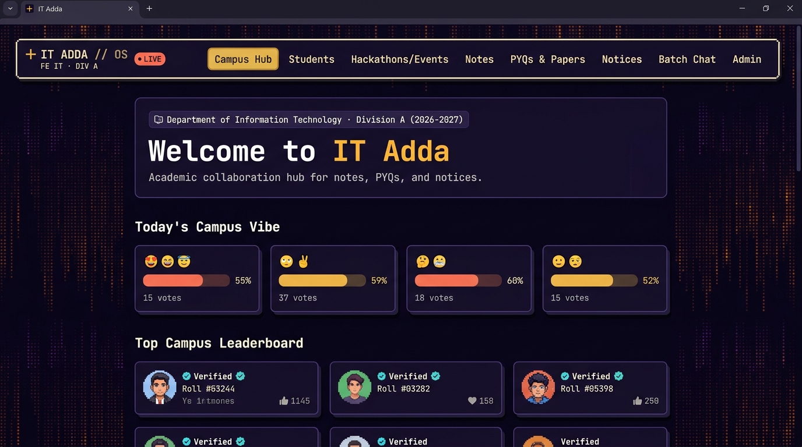

# 🎓 IT Adda — First-Year IT Engineering Campus Hub & Collaboration Portal

<div align="center">



### *Unified Academic Vault, Hackathon Team Builder, Digital ID Cards & Real-Time Community Platform for First-Year IT Engineers*

[](https://react.dev/)
[](https://www.typescriptlang.org/)
[](https://vitejs.dev/)
[](https://tailwindcss.com/)
[](https://firebase.google.com/)
[](https://expressjs.com/)
[](https://threejs.org/)
[](https://web.dev/explore/progressive-web-apps)

</div>

---

## 📖 Project Overview

**IT Adda** (`IT ADDA // OS · FE IT · DIV A`) is a full-stack real-time academic community, resource sharing, and hackathon collaboration web platform built for First-Year Information Technology engineering students.

Instead of letting Previous Year Question (PYQ) papers, lecture notes, circular notices, and hackathon team invites get lost inside noisy WhatsApp chats, **IT Adda** unifies everything into a fast, cloud-synced, retro-terminal inspired campus workspace powered by **React 19**, **Express + Server-Sent Events (SSE)**, **Firebase Firestore**, **Three.js WebGL shaders**, and the **W3C Web Share Target API**.

---

## ✨ Complete Feature List

### 1. 🏠 Campus Hub (Home Dashboard)
- **Today's Campus Vibe Poll:** Interactive daily batch sentiment poll with animated percentage progress bars, instant vote sound effects, and admin-configurable themes/presets (*Normal Study Week*, *Exam Crunch*, *College Fest*, *Hackathon Week*).
- **Top Campus Leaderboard:** Real-time student rankings based on peer likes and reactions, displaying total verified members on the platform.
- **Birthday Celebration Banner & Confetti:** Automatically detects batchmates' birthdays against today's date, showcases a celebratory banner, and launches physics-based `canvas-confetti`.

### 2. 🪪 Verified Student Directory & Gen-Z Digital ID Cards (`Students`)
- **Account Registration & Verification Flow:** Students register with their Full Name, Roll Number (1–63), auto-assigned Batch (`BR1` / `BR2` / `BR3`), Email, Phone Number, Password, Photo, Bio, Skills, and Social links. Profiles enter `PENDING_APPROVAL` until verified by an Admin.
- **Interactive 3D Flip Digital Student ID Cards:** Verified students get a customizable 3D-flippable digital ID card with themed graphics (*Spidey*, *Barbie*, *Cyber Matrix*, *Neon Synthwave*, *Royal Violet*, *Amber Retro*) and 1-click image export.
- **Role & Batch Filtering:** Filter classmates by batch, gender, or leadership roles (`CR Boys`, `CR Girls`, `BR1`, `BR2`, `BR3`, `Developer Admin`), endorse classmates with peer likes/dislikes, and edit personal details anytime.

### 3. 🚀 Hackathons / Events & Verified Team Formation (`Hackathons/Events`)
- **Official Hackathons Directory:** Pre-seeded with **16 upcoming December 2026 Hackathons & Tech Events** featuring organizer/college details, registration deadlines, event dates, prize pools, allowed team sizes, and official registration links.
- **Community Event Submissions:** Students can click **Request to Add Event** (with mandatory Title, Organizer, Deadlines, Dates, Prize Pool, Team Size, and Registration URL) to send new events straight to the Admin approval queue.
- **Verified-Member Team Gate:** Only verified & logged-in IT Adda members (`status === 'APPROVED'`) can create a team or request to join a team. Unregistered or unverified users receive a clear prompt (*"First, register yourself on IT Adda, then create a team or join a team."*) with direct **Register Account** and **Log In** actions.
- **Team Creation & Live Capacity Counters:** Captains can create a team (`2`–`5` members) with Team Name, Captain Name, and Roll Number—starting at `0/N` and updating live as requests are accepted (`1/4`, `3 spaces left`, `Team Full`).
- **Multi-Team Selector Pop-Up:** Clicking **Request to Join** on a hackathon with multiple teams opens a 2-step selector modal asking which team to join (e.g., *Team A*, *Team B*, *Team C*) before collecting Name, Roll Number, and Role (`Developer`, `Designer`, `Researcher`, `AI / ML`, `Backend`, `Presenter`) and sending the request directly to that team's captain.
- **Expandable Teams Dropdown & Clickable Roster Modal:** Each hackathon card features a collapsible `X Team(s) Created` dropdown. Clicking any team opens its full **Team Roster** displaying the **Team Captain** at the top followed by all accepted teammates' roles and roll numbers.
- **Real-Time Captain & Applicant Pop-ups (`HackathonPopups`):** Captains receive automatic pop-ups to **Accept** or **Deny** join requests, while applicants receive instant pop-up alerts when accepted or denied (identifying the team captain).

### 4. ⚡ OS-Level Web Share Target & Global Drag-and-Drop (`PYQs & Papers`)
- **Native WhatsApp / File Manager Sharing:** Installed as a Progressive Web App (`manifest.json` + `sw.js`), IT Adda appears directly inside mobile share sheets alongside WhatsApp, Gmail, and Cloud apps.
- **1-Tap Auto-Metadata Upload:** Sharing or dragging a file anywhere onto IT Adda redirects straight to **PYQs & Papers**, cleans the filename into the exact resource title (e.g., `scientific calculator workshop.pdf` → `scientific calculator workshop`), auto-detects subject and category, and opens a 1-tap upload modal.
- **Subject Vault & Real Binary Downloads:** Browse **Applied Mathematics**, **BEE**, **PPS / Programming**, **Physics**, **Chemistry**, **Mechanics**, and **Engineering Graphics** across PYQs, Formula Sheets, Lab Manuals, Lecture Notes, and Reference Books. Downloads stream authentic binary blobs or generate valid PDF 1.4 documents.

### 5. 📝 Crowdsourced Peer Notes Board (`Notes`)
- **Urgency-Tagged Requests:** Students can post note requests tagged *Exam Tomorrow*, *High*, or *Normal*.
- **Peer & Admin Fulfillment:** Classmates and Admins can upload note attachments or links directly onto open requests and receive community upvotes.

### 6. 🔔 Official Campus Notices (`Notices`)
- **Categorized Department Circulars:** View *Urgent*, *Exam Schedule*, *Lab Submission*, *College Event*, and *General* notices with pinned highlights, file/link attachments, and admin moderation.

### 7. 💬 Live Batch Chat (`Batch Chat`)
- **Real-Time Multi-Device Messaging:** Instant group chat synchronized via Firebase Firestore and Express SSE with message replies and emoji reactions.

### 8. 🛡️ Cryptographically Secured Admin Command Center (`Admin`)
- **HMAC-SHA256 Admin Authentication:** Protected with cryptographically signed tokens, configurable admin credentials, and remote session revocation.
- **Full Platform Governance:**
  - **Student Moderation:** Approve/dismiss registrations, assign CR/BR badges, edit profiles, and adjust/reset student likes.
  - **Hackathons & Team Oversight:** Popup modal to **Add Official Hackathon**, **Manage & Edit Hackathons** (select and update live, pending, or dismissed events), monitor all teams & join requests, and one-click **Reset Hackathon Teams & Requests**.
  - **Content & Vibe Controls:** Moderate notes, notices, and resources; configure Campus Vibe poll questions/counts/presets; customize Developer Footer credits; and export complete JSON database backups.

### 9. 🎮 Retro Terminal Visuals & Web Audio Synthesizer
- **Three.js WebGL Background:** Custom GLSL shader (`FiringPixelMatrixBackground`) rendering an animated pixel matrix backdrop without blocking React UI threads.
- **Synthesized Retro Audio Engine:** Real-time Web Audio API sound effects for clicks, votes, approvals, and an optional ambient fire/terminal crackle toggle in the navbar.

---

## 🏗️ Dual-Layer Real-Time Architecture

```text
  [ Mobile Share Sheet / Browser Client ]
        │
        ├── Web Share Target (sw.js + IndexedDB + /share-target Multer)
        │
        ▼
  [ React 19 + TypeScript + Vite Frontend ]
        │
        ├──► Firebase Cloud Firestore (Real-time onSnapshot WebSockets across devices)
        │
        └──► Express API Server (server.ts + SSE /api/events + /api/database/sync)
```

---

## 📂 Project File Structure

```text
it-adda-campus-portal/
├── data/
│   └── database.json                       # Local server persistent cache
├── public/
│   ├── manifest.json                       # PWA manifest with Web Share Target config
│   ├── sw.js                               # Service Worker (offline + share-target handler)
│   ├── icon-192.png / icon-512.png         # PWA app & maskable icons
│   └── apple-touch-icon.png
├── src/
│   ├── assets/images/
│   │   ├── it-adda-screenshot.jpg          # Platform preview screenshot
│   │   └── ...                             # Campus crests & ID card artwork
│   ├── components/
│   │   ├── AdminPanel.tsx                  # Secured admin dashboard & hackathon/team controls
│   │   ├── BirthdayCelebrationBanner.tsx   # Birthday spotlight & confetti launcher
│   │   ├── BrowseMembers.tsx               # Verified student directory & filters
│   │   ├── FiringPixelMatrixBackground.tsx # Three.js WebGL shader backdrop
│   │   ├── GenZIdCard.tsx                  # Interactive 3D flip student ID card
│   │   ├── HackathonPopups.tsx             # Live captain & applicant decision pop-ups
│   │   ├── HackathonsSection.tsx           # Events directory, verified gate & team builder
│   │   ├── IdCardGraphics.tsx              # ID card visual motifs
│   │   ├── ImpResourcesSection.tsx         # PYQs & academic resource vault
│   │   ├── InteractiveReactionPill.tsx     # Endorsement reaction controls
│   │   ├── Navbar.tsx                      # Responsive terminal dock & quick-share button
│   │   ├── NotesSection.tsx                # Peer notes request & fulfillment board
│   │   ├── NoticeSection.tsx               # Department circulars & announcements
│   │   ├── PersonalDetailsModal.tsx        # Student profile editor
│   │   ├── PhotoUploadField.tsx            # Profile image uploader
│   │   ├── PublicChat.tsx                  # Real-time batch chat
│   │   ├── QuickShareUploadModal.tsx       # 1-tap share-target upload dialog
│   │   ├── RegisterModal.tsx               # Student registration & login modal
│   │   ├── StudentIdCardModal.tsx          # Full-screen ID card viewer & exporter
│   │   └── TopLeaderboard.tsx              # Campus leaderboard & member counter
│   ├── context/
│   │   └── AppContext.tsx                  # Central state, Firestore sync & SSE handlers
│   ├── data/
│   │   ├── hackathonSeedData.ts            # 16 Official December 2026 Hackathons catalog
│   │   └── seedData.ts                     # Default syllabus & bootstrap structures
│   ├── services/
│   │   └── firestoreService.ts             # Firestore CRUD & live snapshot listeners
│   ├── shaders/                            # GLSL CRT & animated dock shader modules
│   ├── utils/
│   │   ├── antiTamperSecurity.ts           # Poll & client integrity guards
│   │   ├── birthdayUtils.ts                # Date matching for batch birthdays
│   │   ├── fileDownloadService.ts          # Binary blob downloader & PDF 1.4 generator
│   │   ├── idCardThemes.ts                 # Digital ID card themes
│   │   ├── imageUtils.ts                   # Image compression & data URL helpers
│   │   ├── shareTargetService.ts           # Web Share Target & title derivation helpers
│   │   ├── soundEffects.ts                 # Web Audio API synth sound engine
│   │   └── studentUtils.ts                 # Roll number & batch helpers
│   ├── App.tsx                             # Root shell, tabs & global drag-and-drop
│   ├── firebase.ts                         # Firebase client initialization
│   ├── main.tsx                            # React DOM mount
│   └── index.css                           # Tailwind CSS v4 & terminal pixel styling
├── .env.example                            # Environment variable template
├── .gitignore                              # Git exclusions
├── firebase-blueprint.json                 # Firestore entity blueprint
├── firestore.rules                         # Firestore security rules
├── metadata.json                           # App metadata
├── package.json                            # Dependencies & npm scripts
├── server.ts                               # Express API, Multer share-target & SSE server
├── tsconfig.json                           # TypeScript configuration
└── vite.config.ts                          # Vite configuration
```

---

## 🚀 Local Setup

1. **Install dependencies**
   ```bash
   npm install
   ```
2. **Configure environment variables**
   Copy `.env.example` to `.env` if setting custom admin credentials locally.
3. **Run development server (Express + Vite on port 3000)**
   ```bash
   npm run dev
   ```
4. **Build for production**
   ```bash
   npm run build
   ```

---

## 👤 Author

- **Lead Developer:** Priyanshu Gupta ([guptapriyanshu0101@gmail.com](mailto:guptapriyanshu0101@gmail.com))
- **Department:** First-Year Information Technology Engineering (Div A)
